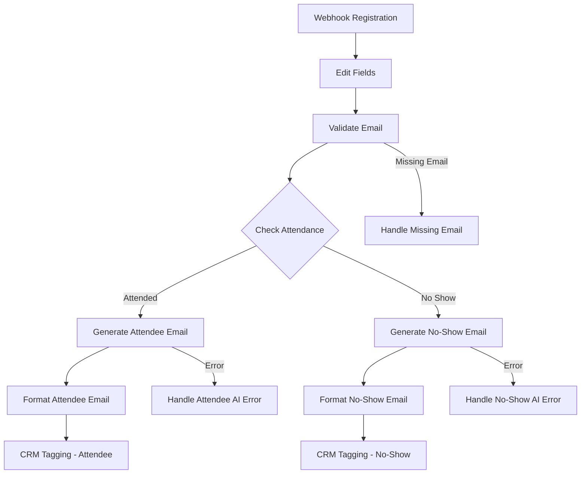

# Webinar Follow-up Automation

An AI-powered webinar follow-up automation workflow built using **n8n**. It helps coaches organize webinar registrations and prepare personalized follow-up emails for attendees and no-shows.

## Project Overview

Following up with webinar participants manually can take time. This automation separates attendees from no-shows, generates appropriate follow-up emails, and prepares CRM tags for each participant.

## Target Audience

Coaches, webinar hosts, and online educators who want to automate their webinar follow-up process.

## Key Features

- **Webhook Registration:** Receives registration data through an n8n webhook.
- **Email Validation:** Checks whether an email address is available.
- **Attendance Segmentation:** Separates attendees and no-shows.
- **AI Email Generation:** Uses an AI model to generate follow-up email content.
- **Personalized Emails:** Prepares separate messages for attendees and no-shows.
- **Replay Link:** Includes a webinar replay link in both email types.
- **CRM Tagging:** Assigns different tags to attendees and no-shows.
- **Missing Email Handling:** Skips records with missing email addresses.
- **Error Handling:** Includes retry settings and error-handling branches for AI generation.

## Technology Stack

- n8n – Workflow automation
- Groq – AI model access
- OpenAI-compatible model: `openai/gpt-oss-20b`
- Webhooks – Registration data input
- Google Sheets – Planned integration

## Workflow Architecture



## Registration Webhook

The workflow accepts POST requests at the webhook path:

`webinar-registration`

Example JSON payload:

```json
{
  "name": "Test Attendee",
  "email": "test@example.com",
  "attendance": "attended",
  "follow_up_status": "pending",
  "crm_tag": ""
}
```

## CRM Tags

| Participant Type | CRM Tag | Follow-up Status |
|---|---|---|
| Attendee | webinar_attended | ready_to_send |
| No-show | webinar_no_show | ready_to_send |

## Email Types

**Attendee Follow-up**

Thanks the participant for attending and provides the webinar replay link.

**No-Show Follow-up**

Acknowledges the registration, mentions the missed session, and provides the webinar replay link.

## Error Handling

- Missing email addresses are skipped.
- AI email-generation nodes have retry settings enabled.
- AI error outputs are connected to dedicated error-handling nodes.
- Error messages and failure status are prepared for handling.

## Setup Instructions

1. Install and run n8n.
2. Import the exported workflow JSON.
3. Configure the required AI model credentials.
4. Activate the webhook workflow.
5. Send registration data using a POST request.
6. Check the execution results and generated email content.

## Testing

The following tests were performed:

- Attendee registration processing.
- No-show registration processing.
- Webhook registration input.
- Email validation.
- Attendee email formatting.
- No-show email formatting.
- CRM tagging for both participant types.
- Missing email handling.

## Current Limitations

- Google Sheets integration is not yet active.
- Live Zoom registration integration has not been configured.
- Gmail delivery is disabled; emails are prepared but not sent.
- The replay URL currently uses a placeholder and should be replaced with the actual recording link.
- Actual AI API failure execution has not yet been tested.

## Project Status

Core attendee and no-show workflow paths have been tested using sample registration data. Additional integrations and deployment steps remain pending.

## Repository

`taw-n8n-webinar-follow-up`

## Project Demo

[Watch 90-Second Demo on Loom](https://www.loom.com/share/eacfe687abce4afabfce6e895d2c4bc0)


## Test Checklist

- [x] Webhook receives registration data successfully.
- [x] Email validation for valid email addresses.
- [x] Attendee follow-up email generation.
- [x] No-show follow-up email generation.
- [x] Attendee CRM tagging.
- [x] No-show CRM tagging.
- [x] Missing email handling.
- [x] AI retry configuration (3 attempts).
- [x] AI error-handling branches configured.
- [ ] Actual Gmail email delivery.
- [ ] Live Zoom integration.
- [ ] Google Sheets integration.


## Error Handling

- Email validation prevents processing registrations with missing email addresses.
- AI email generation nodes are configured to retry failed requests up to 3 times.
- If AI generation still fails, the error-handling branch records the error type, message, and failure status.
- Failed email generation does not proceed as a successful follow-up.
